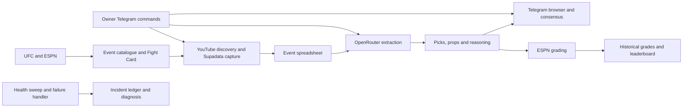

# UFC n8n workflows

Documentation and sanitized snapshots of the UFC prediction automation running on [the n8n instance](https://N8N_INSTANCE.example/), captured on **30 October 2026**.

The system discovers UFC events and YouTube prediction videos, captures English transcripts, extracts picks and reasoning, presents saved analysis through Telegram, computes consensus, grades completed fights and monitors its own health.

## Start here

- [How the system works](docs/architecture.md): lifecycle, data flow and interactions.
- [All 28 workflows](docs/workflows.md): individual explanations, inputs, dependencies, writes, safeguards, every node and every graph edge.
- [Telegram commands](docs/telegram.md): day-to-day use and what each action actually does.
- [Schedules](docs/schedules.md): exact configured trigger rules and timezone caveats.
- [Data model](docs/data-model.md) and [complete table schemas](docs/data-tables.md).
- [Monitoring and incident handling](docs/monitoring.md): retries, diagnosis, alerts and resolution.
- [Operations and recovery](docs/operations.md): setup, testing, troubleshooting, restore and updates.
- [Interfaces](docs/interfaces.md): caller payloads and response semantics.
- [Credentials](docs/credentials.md), [dependency graph](docs/dependencies.md) and [verification record](docs/verification.md).
- [Privacy review](docs/privacy-review.md): redactions, retained configuration and safe restoration.
- [Shorts exclusion policy](docs/shorts-filter.md): duration checks across capture, analysis and submitted videos.



The arrows above include shared-data dependencies. Capture and analysis are separately scheduled workers; capture does not automatically call analysis. `/addvideo` deliberately runs both for one submitted video.

## Repository contents

| Path | Contents |
| --- | --- |
| `docs/` | Human operating guide and detailed reference |
| `workflows/` | 28 sanitized workflow JSON snapshots |
| `source/` | 128 extracted Code-node JavaScript files, indexed by workflow and node |
| `inventory/` | Version/hash manifest and ten data-table schemas, with no table rows |
| `scripts/` | Reference generator, editorial workflow descriptions and verification script |

All 28 workflows were published, with published graphs matching their drafts when read. The inventory covers the UFC workflows visible through MCP, including the diagnostics workflow's AI Agent node. Separate first-class Agents, credentials, execution history, Google spreadsheet contents, template contents and unrelated projects are outside these exports.

These snapshots omit credential IDs/values, webhook IDs, pinned data and execution data. Credential names use generic type-based aliases. Owner chat IDs become the disabled placeholder `0`; instance addresses, bot links, personal email addresses and private Google file/folder identifiers use placeholders. Internal workflow/table/version IDs remain for dependency tracing; they are resource identifiers, not authentication secrets. Rebind all placeholders when restoring. The snapshots are a reference and recovery input; they are not a complete one-click backup of accounts, credentials, data or activation state.

## Verify locally

```sh
python3 scripts/verify-docs.py
```

No live workflow is executed by this check. See [maintenance](docs/operations.md#refresh-this-repository) before regenerating from new snapshots.
