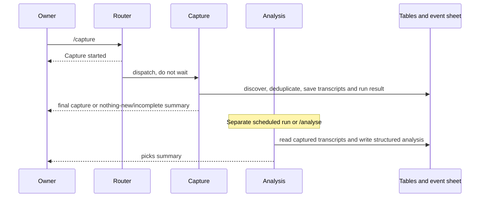
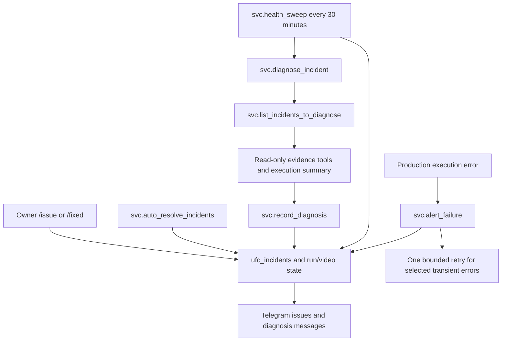

# System architecture

## One event is the working context

`ufc_events` is the event catalogue. Each event has an `event_key`, a start timestamp, an active flag and a spreadsheet reference. Most current-event operations expect exactly one active event. Workflow 4 discovers/updates upcoming events; workflow 1 picks the nearest future event and marks it active. The active event is a shared-data dependency rather than an argument passed through every route.

`svc.ensure_event_spreadsheet` is the shared setup service. It reuses a saved spreadsheet, searches Drive for an existing event copy, or copies the configured template. It saves the reference and calls `svc.populate_fight_card`. This means activation, capture and analysis can all ensure setup without each containing a separate template-copy implementation.

## Capture and analysis are distinct stages

Workflow 2 resolves uploads playlists for 13 tracked YouTube channels through YouTube Data API v3. It reads recent playlist pages, filters video titles against the active and known events, excludes formats such as reactions/DFS/early predictions and checks the video ledger. Supadata supplies English native captions. Successful transcripts are split into spreadsheet-safe parts and stored in `Transcripts`; `ufc_videos` tracks capture status and attempts.

Workflow 3 subsequently reads captured videos needing analysis. It reconstructs transcript parts, supplies the official Fight Card to OpenRouter, validates structured extraction and writes Picks, Props, Fight Analysis and Extraction Log. Completed/failed processing and model metadata are recorded in `ufc_videos`; run outcomes are recorded in `ufc_pipeline_runs`.

Both capture and analysis verify video duration before paid extraction/model work. Videos at or below 181 seconds (three minutes plus API rounding tolerance), explicit Shorts markers and unverified duration are blocked. `/addvideo` applies the same policy before reservation. This conservative rule also excludes short landscape clips. See the [Shorts policy](shorts-filter.md) for tests and treatment of previously saved data.

Neither a Telegram dispatch acknowledgement nor a successful API discovery request proves extraction finished. Capture and analysis have independent completion paths. Ordinary Capture does not invoke analysis; the analysis schedule or `/analyse` does. A failed API channel can also be handled without failing the entire n8n execution, so the application ledger and final summary carry essential meaning.

## Two ways to ingest a video

`/addvideo URL` instead calls `svc.add_video`. It validates a public YouTube URL through oEmbed, confirms a unique future active event and title match, reserves/claims the video, invokes targeted capture and waits, rereads its state, then invokes targeted analysis only when appropriate. Both workers receive a single target. This route does not scan or reprocess every channel.

`/retry` uses `svc.retry_video` to select a capture or analysis stage for one unfinished saved video. It records the request without resetting attempt counts and dispatches the selected worker asynchronously. It refuses already completed analyses and already captured capture requests.

## Fight-card integrity comes before model extraction

The Fight Card is based on official UFC order/names, with ESPN verification of competitors and rounds. UFC requests carry the US-region cookie to prevent an unexpected regional site edition. Existing extraction is protected before initial card writes.

Four services keep later changes aligned:

1. `svc.sync_bout_ids` establishes durable bout IDs on the card and extracted rows. `fight_order` is presentation order and can change.
2. `svc.detect_card_changes` compares the official card to the saved card and records proposed changes in `ufc_fight_card_state` without editing the sheet.
3. `svc.apply_card_changes` applies confirmed changes, verifies writes, renumbers or voids affected extraction and marks appropriate videos `CARD_CHANGED`.
4. The next analysis pass selects those videos for re-extraction. Uncertain removals, bulk removals and partial writes remain visible through pending/review state.

`svc.check_event_spreadsheet` guards tab/header compatibility before model extraction. A schema mismatch is an intentional stop, not a reason to bypass validation.

## Views reuse saved results

The Telegram router is the owner-facing entry point. `/videos` lists captured active-event videos; `/video` reopens saved picks and prop reasoning. The browser does not run an LLM. `/status` combines ledger, video and card state to show where work stands.

Workflow 6 computes consensus from the latest official pick for each channel/fight, ignoring voided rows. Confidence drives vote weight, with a small historical-record adjustment. Explanation text is cached against the inputs. A plain vote mode gives each channel equal weight. Scheduled digest checks only proceed 1–30 hours before the event.

Workflow 7 selects completed events, obtains ESPN results and grades supported picks/props into historical data tables. Workflow 8 reads those tables for the all-time leaderboard. Historical grades also feed the small consensus record adjustment, creating a feedback dependency rather than an execution cycle.

## Monitoring is a parallel control system

The failure handler captures explicit production errors. The sweep catches conditions that can otherwise look successful, such as stuck ledger entries, missing active events and pending card changes. Diagnosis proposes fixes; it does not edit or publish workflows. Auto-resolution and manual resolution change the incident record, not the underlying code.

Workflow 9 independently checks OpenRouter credits and warns according to balance state and notification rules. Full call edges, synchronous/asynchronous settings and AI-tool connections are in the [dependency reference](dependencies.md) and individual workflow pages.
