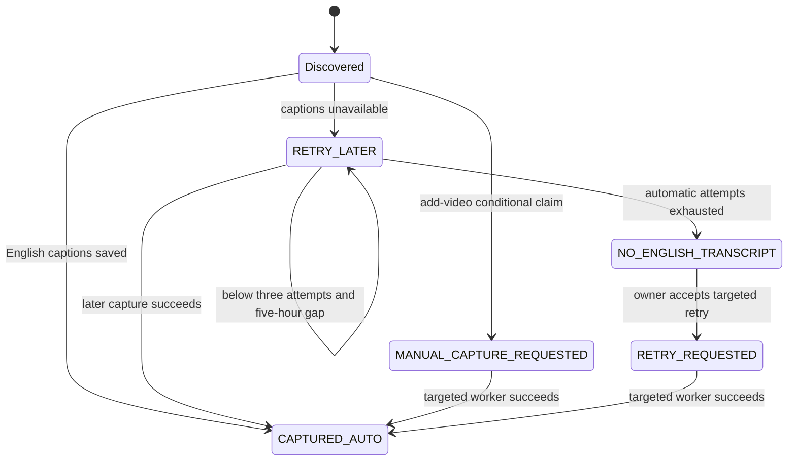
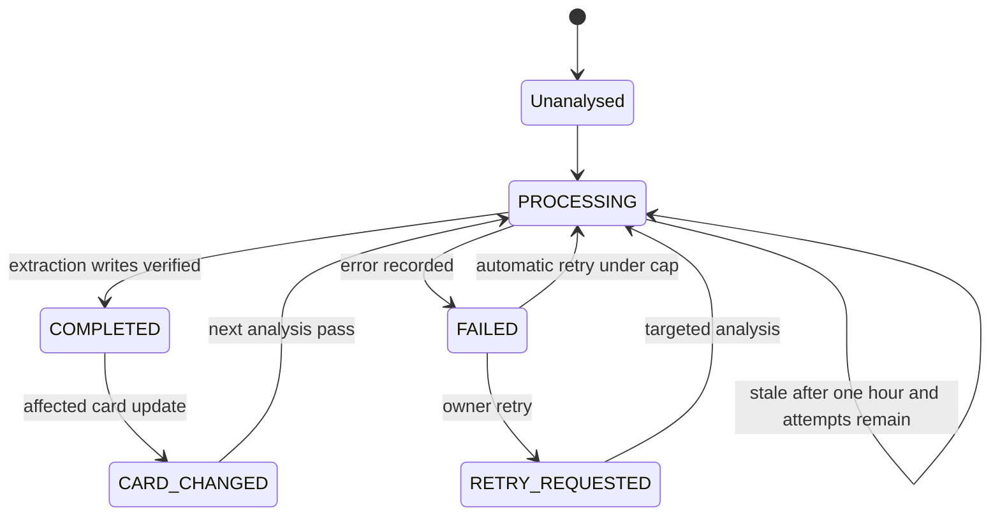

# Data model and state transitions

The durable application state is split between ten n8n data tables and one Google spreadsheet per event. The [table schema reference](data-tables.md) lists every observed column and type. The JSON schema export contains no row data.

## Tables and ownership

| Table | Role | Main writers and consumers |
| --- | --- | --- |
| `ufc_events` | Event identity, start time, active flag, spreadsheet reference and grading marker | Event discovery/activation, spreadsheet setup, card population and grading; read by event-scoped services |
| `ufc_videos` | Capture/analysis lifecycle, retries, title match evidence and model metadata | Capture, analysis, add-video, retry, card-change application and failure handling; read by status/browser/health |
| `ufc_pipeline_runs` | Per-execution application ledger, including running/final state and execution link | Capture/analysis and failure handler; read by status and health sweep |
| `ufc_fight_card_state` | Verified card fingerprint, source card, pending differences and review/apply state | Card population/sync/detection/application; read by schema checks, status and health |
| `ufc_fight_results` | ESPN bout results and normalized finish details | Grading workflow |
| `ufc_pick_grades` | Winner-pick results keyed by pick ID | Grading; consumed by leaderboard and consensus record weighting |
| `ufc_prop_grades` | Supported prop results keyed by prop ID | Grading; consumed by leaderboard |
| `ufc_consensus_cache` | Explanation text, input hash, model and cost | Consensus workflow |
| `ufc_monitor_state` | OpenRouter balance state and alert-delivery timestamp | Credit workflow |
| `ufc_incidents` | Error/health/owner incidents, recurrence, claims, diagnosis and resolution | Failure handler, sweep, diagnosis services and owner issue services |

## Keys and relationships

`event_key` joins the catalogue, video rows, event sheet extraction, grades, card state and consensus cache. `spreadsheet_id` identifies the event's external storage and also appears in card state. Do not move a saved video to a new event merely because the active event changed.

`video_id` is the canonical YouTube ID. Capture upserts by that ID; saved transcript records additionally identify each chunk. `part_number` and `part_count` reconstruct complete transcripts in order. An incomplete/missing set of chunks is different from a transcript being successfully captured.

`bout_id` is the stable fight identity, ideally an official `ufc:...` identity. `fight_order` is its current position on the event card. Pick, prop and fight-analysis IDs are built using stable bout associations, so card rearrangements do not repoint an existing prediction to another fight. Read `Prepare Extraction Rows` and `Plan Bout IDs` for the exact ID construction and migration rules.

`run_key` identifies a recorded n8n execution. `state=success` or `idle` is application-level evidence consumed by the health sweep. A platform execution may succeed after handling an upstream item error; it is not equivalent to a fully healthy channel scan.

`incident_key` identifies a recurring issue. Error signatures normalize changing IDs/numbers/URLs; health keys identify a condition and subject; owner reports have their own deduplication path. System row IDs are also accepted by the owner-resolution service.

## Spreadsheet contract

| Tab | Contents and important fields |
| --- | --- |
| `Fight Card` | A:H: fight_order, fighter_a, fighter_b, fighter_a_aliases, fighter_b_aliases, bout_type, scheduled_rounds, weight_class; I holds bout_id after synchronization |
| `Transcripts` | Chunk records with record_id, channel/video metadata, part_number, part_count, transcript_text and capture metadata |
| `Picks` | pick_id, event/video/channel, bout/order/fighters, picked_fighter, confidence, official-pick marker, evidence, reasoning and review/model metadata |
| `Props` | prop_id, event/video/channel, bout/order/fighters, market, selection, method/round/duration details, stake/confidence/recommendation strength, evidence and reasoning |
| `Fight Analysis` | fight_analysis_id, event/video/channel and bout identity, fighter contexts and fight_outlook |
| `Extraction Log` | extraction_id, input/part counts, model/provider/prompt, tokens/cost, output counts and validation status/error |

The exact required/optional header arrays are embedded in `svc.check_event_spreadsheet` → `Prepare Schema Check`, exported in its [snapshot](../workflows/svc-check-event-spreadsheet.json). Its validation is the runtime authority; this summary is not a substitute for the exact arrays. Some Picks duplicate metadata headers are explicitly tolerated for legacy templates. Optional `bout_id` support is completed by the synchronization service. The template must also have sufficient grid width for every read/write range.

## Capture lifecycle

`status` is capture/request state; `transcript_appended` and `transcript_parts` separately record the saved transcript. Do not infer analysis completion from `CAPTURED_AUTO`. Automatic discovery excludes already-recorded non-RETRY_LATER rows. Owner retry is an explicit exception and does not reset attempt history.

## Analysis lifecycle

Automatic selection normally uses three attempts. A targeted manual request can exceed that cap; `CARD_CHANGED` is independently eligible. Completion should be assessed with status, execution link, timestamps, extraction log and expected sheet rows. Multi-tab writes and their ledger update are not one transaction.

## Card and incident state

Card `status` and `change_status` are separate dimensions. Initial setup can be READY/PRESERVED or pending; later differences can be CHANGED, PARTLY_APPLIED or NEEDS_REVIEW. Pending source snapshots and fingerprints let the change worker verify what it is applying. More than three simultaneous removals triggers its bulk-removal review gate.

Incidents use open/retrying/resolved state plus separate diagnosis_status, diagnosis_by, diagnosed_at and diagnosis_attempts. Diagnosis does not imply resolution. Resolution records a manual judgement, a cleared condition, subsequent success evidence or a quiet-period inference; read `resolution` to distinguish them.
