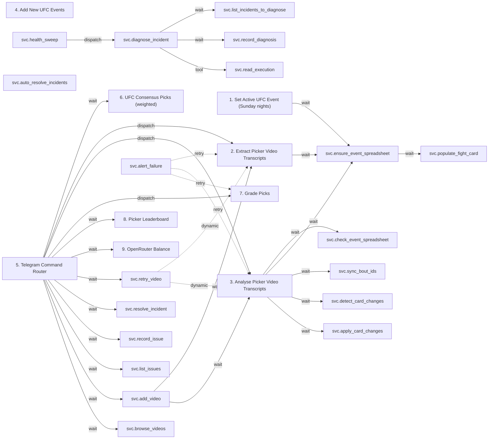

# Workflow call graph

Solid edges are explicit child-workflow/tool calls in the saved configuration. Dashed edges are the validated dynamic retry targets. Shared tables and sheets create additional data dependencies; they are described in the architecture guide. Error-handler links are documented per workflow and omitted here to keep the diagram readable.

